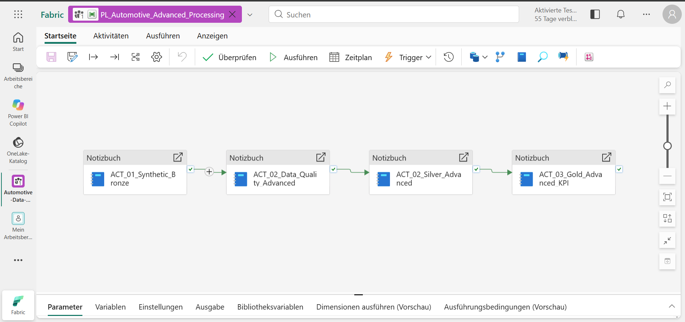
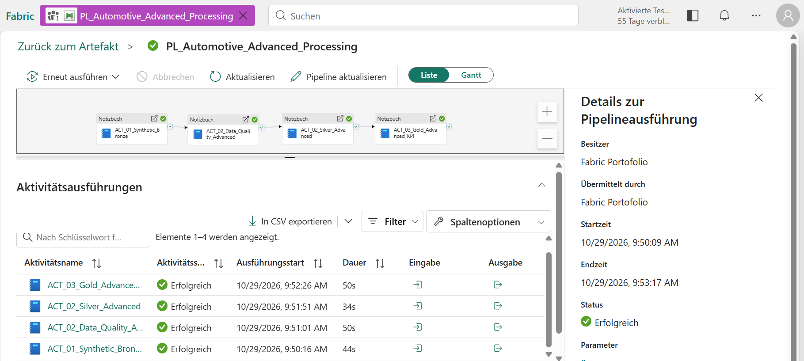
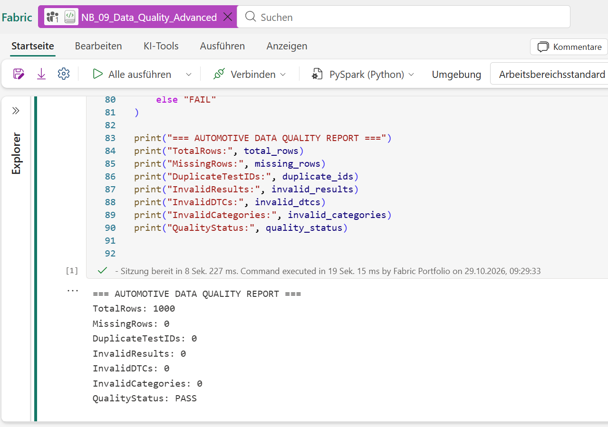
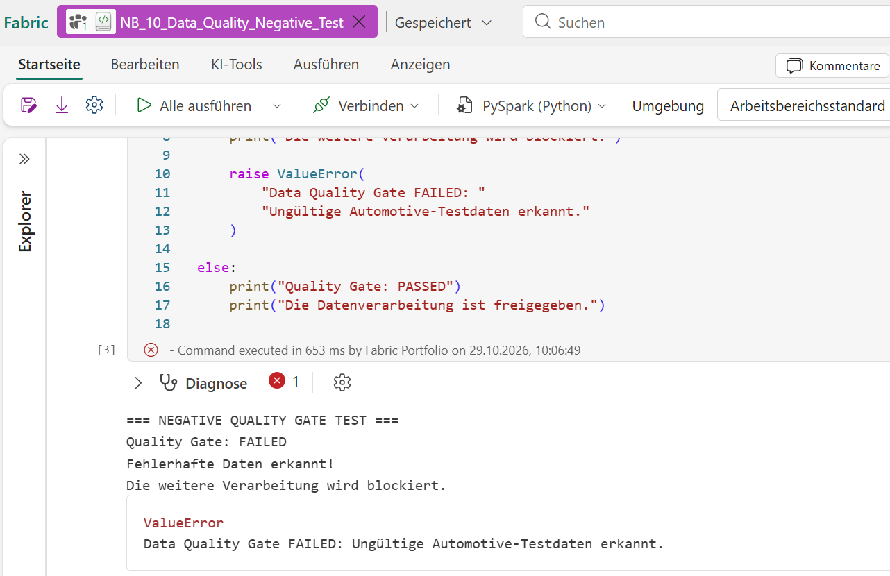
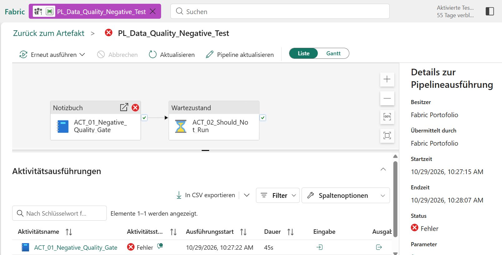
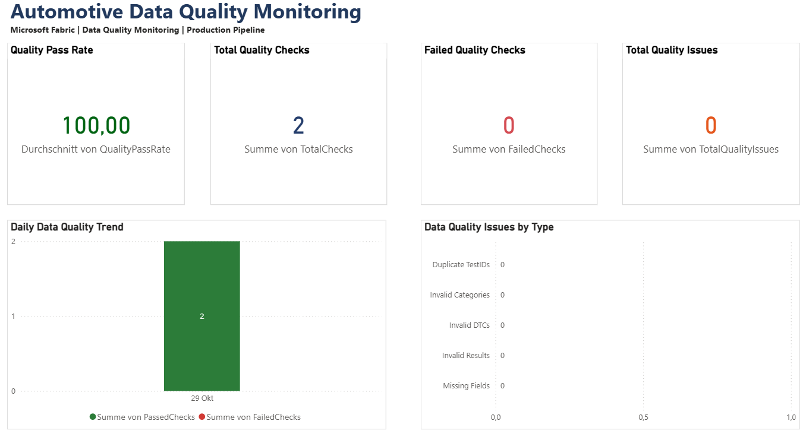
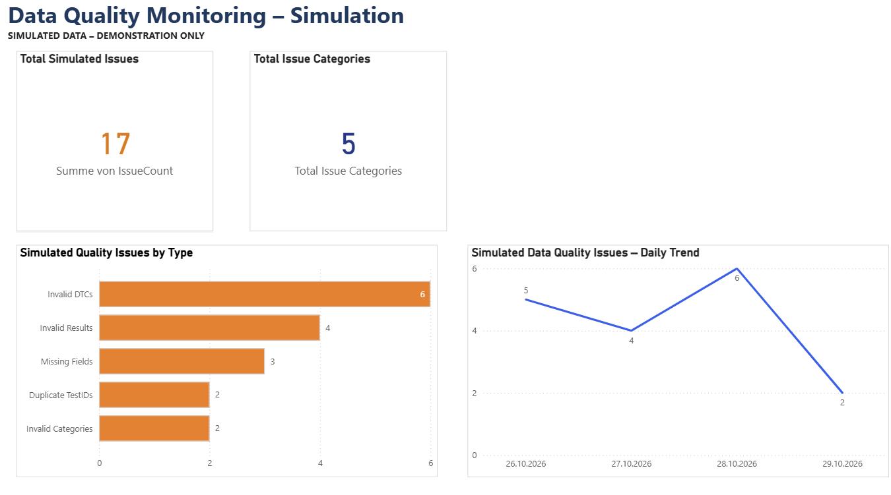

# Automotive Data Engineering & Quality Monitoring

### Microsoft Fabric | PySpark | Delta Lake | SQL | Power BI

[Deutsch](README_DE.md) | **English**

## Project Overview

This portfolio project demonstrates an end-to-end automotive data engineering solution built with Microsoft Fabric.

The solution processes 1,000 synthetic automotive diagnostic test records using a Bronze–Silver–Gold (Medallion) architecture.

It includes automated data pipelines, PySpark transformations, data quality validation, error handling, SQL-based monitoring, and Power BI dashboards.

### Key Features

- Automated Bronze–Silver–Gold data processing
- Synthetic automotive diagnostic data generation
- Data cleaning and validation using PySpark
- Data quality gates with positive and negative tests
- Delta Lake storage in Microsoft Fabric Lakehouse
- SQL validation and monitoring views
- Quality KPIs by ECU, error category, and month
- Power BI dashboards for monitoring and simulated error scenarios

**Data disclaimer:** All automotive diagnostic records are synthetic and intended for educational and portfolio demonstration purposes. No confidential vehicle or company data is used.

# Automotive Data Engineering & Quality Monitoring

### Microsoft Fabric | PySpark | Delta Lake | SQL | Power BI

[Deutsch](README_DE.md) | **English**

## Project Overview

This portfolio project demonstrates an end-to-end automotive data engineering solution built with Microsoft Fabric.

The solution processes 1,000 synthetic automotive diagnostic test records using a Bronze–Silver–Gold (Medallion) architecture.

It includes automated data pipelines, PySpark transformations, data quality validation, error handling, SQL-based monitoring, and Power BI dashboards.

### Key Features

- Automated Bronze–Silver–Gold data processing
- Synthetic automotive diagnostic data generation
- Data cleaning and validation using PySpark
- Data quality gates with positive and negative tests
- Delta Lake storage in Microsoft Fabric Lakehouse
- SQL validation and monitoring views
- Quality KPIs by ECU, error category, and month
- Power BI dashboards for monitoring and simulated error scenarios

**Data disclaimer:** All automotive diagnostic records are synthetic and intended for educational and portfolio demonstration purposes. No confidential vehicle or company data is used.

---

## Solution Architecture

The solution is implemented in Microsoft Fabric using a Lakehouse with schema-enabled Delta tables. Data processing is orchestrated through Fabric Data Pipelines and PySpark notebooks.

### Processing Flow

```text
Synthetic Automotive Diagnostic Data
                 |
                 v
        BRONZE LAYER
   Data generation and ingestion
                 |
                 v
         DATA QUALITY GATE
   Validation, logging, PASS/FAIL
                 |
            PASS only
                 |
                 v
         SILVER LAYER
   Cleaning and transformation
                 |
                 v
          GOLD LAYER
   ECU / Error / Monthly KPIs
                 |
                 v
      SQL Analytics Endpoint
                 |
                 v
        POWER BI REPORTING
```

### Bronze Layer

Notebook: `NB_06_Synthetic_Data_Generator`

Table: `bronze.synthetic_vehicle_diagnostics`

Generates 1,000 reproducible synthetic diagnostic test records with attributes including ECU, diagnostic trouble code (DTC), error category, test result, and timestamp.

### Data Quality Gate

Notebook: `NB_09_Data_Quality_Advanced`

Log table: `dbo.synthetic_data_quality_log`

Validates mandatory fields, duplicate test IDs, test result values, DTC formats, and error categories. Quality results are appended to a Delta log table.

If a quality check fails, the notebook raises an exception, preventing downstream processing through success-only pipeline dependencies.

### Silver Layer

Notebook: `NB_07_Silver_Advanced`

Table: `silver.synthetic_vehicle_diagnostics_clean`

Standardizes and validates diagnostic records, removes invalid entries and duplicate test IDs, and writes the cleaned dataset to a Delta table.

### Gold Layer

Notebook: `NB_08_Gold_Advanced_KPI`

Tables:

- `gold.synthetic_ecu_quality_kpis`
- `gold.synthetic_error_category_kpis`
- `gold.synthetic_monthly_quality_kpis`

Calculates test volumes, PASS/FAIL counts, and quality rates by ECU, error category, and month.

### Pipeline Orchestration

Main pipeline: `PL_Automotive_Advanced_Processing`

Execution sequence:

1. `ACT_01_Synthetic_Bronze`
2. `ACT_02_Data_Quality_Advanced`
3. `ACT_02_Silver_Advanced`
4. `ACT_03_Gold_Advanced_KPI`

Each activity depends on the successful completion of the preceding activity. The end-to-end pipeline was successfully executed and its data counts validated using SQL.

---

## Data Quality & Testing Strategy

Data quality validation is integrated into the automated Microsoft Fabric pipeline to ensure that invalid diagnostic records are detected before downstream processing.

### Data Quality Rules

The Data Quality Gate validates the following conditions:

| Validation Rule | Description |
|---|---|
| Record Count | Expected dataset size: 1,000 records |
| Mandatory Fields | Detect missing values in required columns |
| Duplicate Test IDs | Identify duplicated TestID groups |
| Test Result Validation | Accept only PASS or FAIL |
| DTC Format Validation | Validate diagnostic trouble code syntax |
| Error Category Validation | Accept only predefined error categories |

### Positive Test

**Notebook:** `NB_09_Data_Quality_Advanced`

The positive test validates 1,000 synthetic diagnostic records.

**Observed results:**

| Metric | Result |
|---|---:|
| Total Records | 1,000 |
| Missing Mandatory Fields | 0 |
| Duplicate TestID Groups | 0 |
| Invalid Test Results | 0 |
| Invalid DTC Formats | 0 |
| Invalid Error Categories | 0 |
| Quality Status | PASS |

The successful validation allows the pipeline to continue with Silver transformation and Gold KPI processing.

### Negative Test

**Notebook:** `NB_10_Data_Quality_Negative_Test`

A separate synthetic dataset containing five records was created with deliberately introduced quality issues.

Detected issues included:

- One missing TestID
- One duplicate TestID group
- One invalid test result
- One invalid DTC format
- One invalid error category

**Observed result:** `QualityStatus: FAIL`

The Quality Gate raised the expected `ValueError`, confirming that invalid data triggers a controlled notebook failure.

### Pipeline Integration Testing

**Test pipeline:** `PL_Data_Quality_Negative_Test`

The negative integration test contained:

1. A notebook activity executing the negative quality test
2. A downstream Wait activity configured with an On-Success dependency

**Observed behavior:**

- The Quality Gate activity failed with the expected exception.
- The overall pipeline run failed as expected.
- The downstream Wait activity was not observed executing.
- The success-only dependency was verified.

**Test conclusion:** PASSED – Expected failure handling was demonstrated.

### SQL Data Validation

SQL validation scripts verify consistency between the Silver dataset and the three Gold KPI aggregations.

The following checks were completed:

- Bronze/Silver/Gold record-count consistency
- PASS/FAIL count reconciliation
- Aggregated totals across ECU, error category, and month

All three Gold aggregations reconciled with the 1,000-record Silver dataset during validation.

### Data Quality Logging

Quality-check results are stored in:

`dbo.synthetic_data_quality_log`

Each log entry contains validation metrics, a quality status, and a timestamp.

These records support SQL-based monitoring and Power BI reporting.

### Test Data Isolation

All diagnostic data is synthetic.

Negative tests use separate test DataFrames and a dedicated test pipeline. Existing Bronze, Silver, and Gold datasets were not modified during these tests.

The negative test dataset is intentionally excluded from production-style monitoring metrics.

---

## SQL Analytics & Power BI Reporting

### SQL Analytics

The Microsoft Fabric Lakehouse SQL analytics endpoint is used to validate processed data, query aggregated KPIs, and support data quality monitoring.

The project includes five documented SQL scripts:

| SQL Script | Purpose |
|---|---|
| `01_bronze_silver_gold_validation.sql` | Validate record counts across Bronze, Silver, and Gold layers |
| `02_pass_fail_consistency_validation.sql` | Reconcile PASS/FAIL counts between Silver and Gold |
| `03_data_quality_monitoring.sql` | Analyze overall and daily data quality metrics |
| `04_data_quality_views.sql` | Define reusable SQL monitoring views |
| `05_quality_issues_and_simulation.sql` | Analyze actual and simulated data quality issues |

### Monitoring Views

The following SQL views support reporting and monitoring:

- `dbo.vw_data_quality_kpis` – Overall data quality KPIs
- `dbo.vw_daily_data_quality_monitoring` – Daily quality trends
- `dbo.vw_data_quality_issues_by_type` – Quality issues grouped by validation rule
- `dbo.vw_simulated_data_quality_issues` – Simulated issue data for demonstration purposes

### Power BI Reporting

**Report:** `powerbi/Automotive_Data_Quality_Monitoring.pbix`

The Power BI report contains two pages.

#### Page 1 – Data Quality Monitoring

This page presents actual quality-check results recorded by the Fabric project pipeline.

Visualizations include:

- Quality Pass Rate
- Total Quality Checks
- Failed Quality Checks
- Total Quality Issues
- Daily Data Quality Trend
- Data Quality Issues by Type

The page helps monitor data validation outcomes and identify potential data quality issues.

#### Page 2 – Data Quality Simulation

This page demonstrates how data quality problems can be analyzed using explicitly simulated data.

It includes:

- 17 simulated quality issues
- 5 issue categories
- Issue distribution by category
- Daily issue trends from October 26–29, 2026

All simulated values are clearly labeled **SIMULATED DATA – DEMONSTRATION ONLY**.

### Data Connectivity

Power BI Desktop connects to the Microsoft Fabric Lakehouse SQL analytics endpoint using imported SQL views.

The report uses Import mode. Therefore, new source data becomes visible after a dataset refresh rather than automatically appearing in the existing report.

### Reporting Purpose

The solution demonstrates the integration of data engineering, data validation, SQL analytics, and business intelligence within a Microsoft Fabric environment.

It provides an example of how diagnostic test results and data pipeline quality can be transformed into actionable reporting information.

**Disclaimer:** All vehicle diagnostic records are synthetic. The solution is a portfolio demonstration, not a deployed enterprise production system.

---

## Project Screenshots

The following screenshots demonstrate the Microsoft Fabric pipeline architecture, automated execution, data quality validation, error handling, and Power BI reporting.

### 1. Automated Data Pipeline

The advanced pipeline orchestrates synthetic data generation, data quality validation, Silver transformation, and Gold KPI calculations.



### 2. Successful Pipeline Execution

All four notebook activities completed successfully during the end-to-end pipeline execution.



### 3. Data Quality Gate – Positive Test

The Data Quality Gate successfully validated 1,000 synthetic automotive diagnostic records with no detected quality violations.



### 4. Data Quality Gate – Negative Test

A deliberately invalid dataset triggered a `ValueError`, demonstrating controlled notebook failure.



### 5. Pipeline Negative Integration Test

The negative test pipeline failed as expected. The downstream Wait activity was not observed executing, and its success-only dependency was verified.



### 6. Power BI – Data Quality Monitoring

Monitoring dashboard with quality KPIs, daily quality trends, and issue distribution.



### 7. Power BI – Data Quality Simulation

Simulation dashboard demonstrating 17 synthetic quality issues across five categories.



**Note:** All screenshots are provided for portfolio demonstration purposes. The simulation dashboard contains explicitly labeled synthetic results.

---

## Technologies & Tools

| Technology | Application in This Project |
|---|---|
| Microsoft Fabric | Integrated data engineering and analytics platform |
| Fabric Lakehouse | Storage and management of Delta tables |
| Apache Spark / PySpark | Synthetic data generation, cleaning, validation and aggregation |
| Delta Lake | Bronze, Silver and Gold data storage |
| Fabric Data Pipelines | Automated notebook orchestration |
| SQL / T-SQL | Data validation, KPI reconciliation and monitoring views |
| Power BI Desktop | Interactive data quality monitoring and simulation reports |
| DAX | Measures and calculated tables for reporting |
| Git / GitHub | Version control and portfolio documentation |

## Repository Structure

```text
Automotive-Fabric-Data-Engineering/
│
├── notebooks/
│   ├── NB_01_Bronze_Ingestion.ipynb
│   ├── NB_02_Silver_Transformation.ipynb
│   ├── NB_03_Gold_KPI.ipynb
│   ├── NB_04_Data_Quality.ipynb
│   ├── NB_05_Data_Quality_Test.ipynb
│   ├── NB_06_Synthetic_Data_Generator.ipynb
│   ├── NB_07_Silver_Advanced.ipynb
│   ├── NB_08_Gold_Advanced_KPI.ipynb
│   ├── NB_09_Data_Quality_Advanced.ipynb
│   └── NB_10_Data_Quality_Negative_Test.ipynb
│
├── pipelines/
│   ├── PL_Automotive_Data_Processing.json
│   ├── PL_Automotive_Advanced_Processing.json
│   └── PL_Data_Quality_Negative_Test.json
│
├── sql/
│   ├── 01_bronze_silver_gold_validation.sql
│   ├── 02_pass_fail_consistency_validation.sql
│   ├── 03_data_quality_monitoring.sql
│   ├── 04_data_quality_views.sql
│   └── 05_quality_issues_and_simulation.sql
│
├── powerbi/
│   └── Automotive_Data_Quality_Monitoring.pbix
│
├── screenshots/
│   ├── 01_advanced_pipeline.png
│   ├── 02_pipeline_success.png
│   ├── 03_data_quality_gate.png
│   ├── 04_data_quality_negative_test.png
│   ├── 05_pipeline_negative_test.png
│   ├── 06_powerbi_data_quality_monitoring.png
│   └── 07_powerbi_data_quality_simulation.png
│
├── README.md
└── README_DE.md
```

*Note: `README_DE.md` will be added in the next documentation phase.*

## Project Highlights

- Built and validated an automated four-stage Microsoft Fabric pipeline.
- Processed 1,000 reproducible synthetic automotive diagnostic records.
- Implemented data quality checks, logging and controlled failure handling.
- Validated Bronze, Silver and Gold datasets using SQL.
- Developed reusable SQL monitoring views.
- Created a two-page Power BI report for actual quality logs and simulated error scenarios.
- Demonstrated both positive and negative testing scenarios.

## Limitations

This is a portfolio demonstration based on synthetic data. Diagnostic results and error categories were generated independently and do not represent real vehicle failure probabilities.

The solution is not a production deployment. Additional operational requirements such as production security controls, automated deployment, alerting and scalability testing would be necessary for enterprise use.
