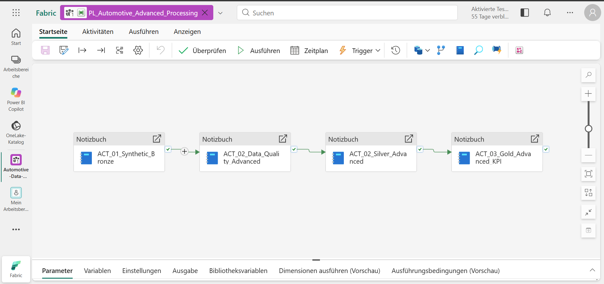
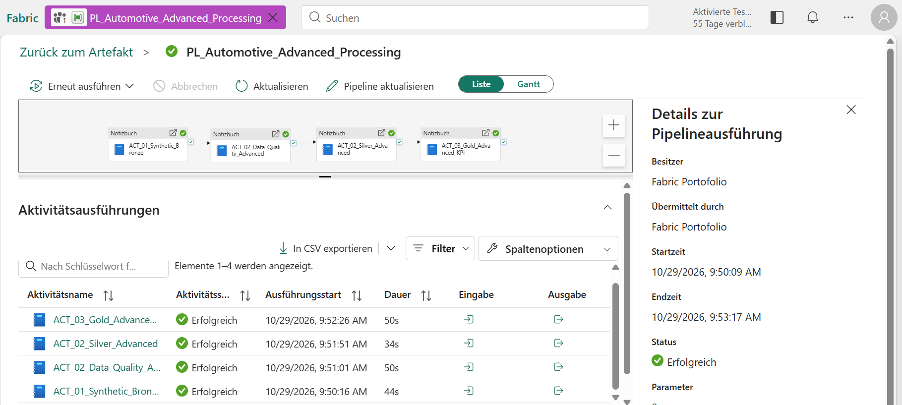
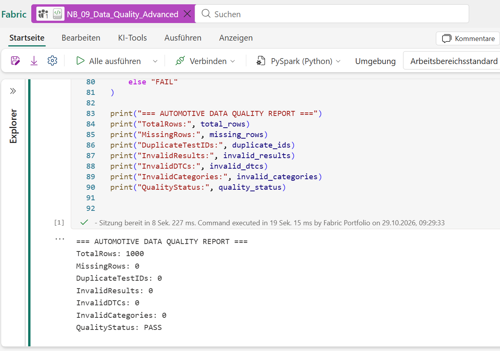
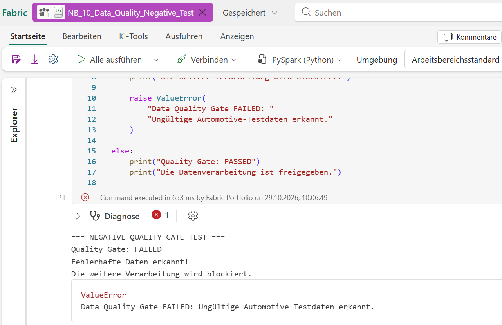
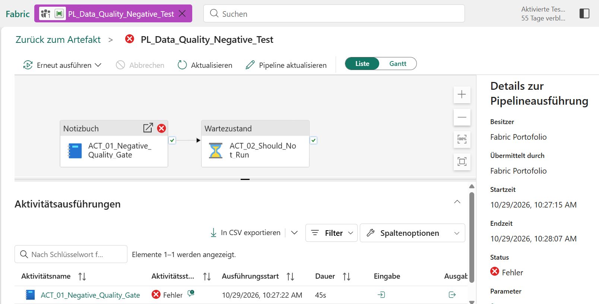
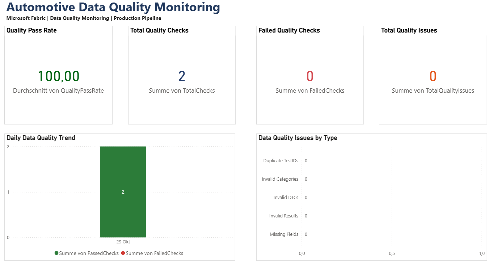
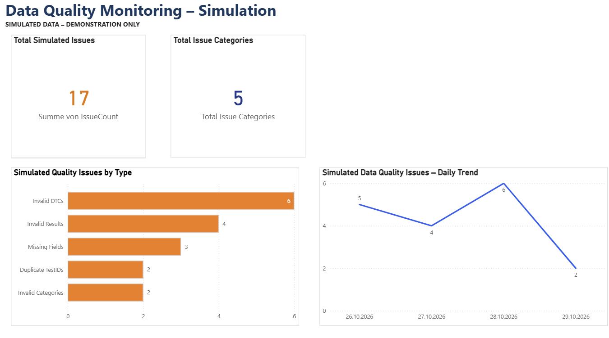

# Automotive Data Engineering & Quality Monitoring

### Microsoft Fabric | PySpark | Delta Lake | SQL | Power BI

**Deutsch** | [English](README.md)

## Projektübersicht

Dieses Portfolio-Projekt demonstriert die Entwicklung einer automatisierten Data-Engineering- und Datenqualitätslösung für den Automotive-Bereich mit Microsoft Fabric.

Die Lösung verarbeitet 1.000 synthetisch erzeugte Fahrzeugdiagnose-Testfälle mithilfe einer **Bronze-Silver-Gold-Architektur (Medallion Architecture)**.

Das Projekt verbindet Datenverarbeitung, automatisierte Qualitätskontrollen, SQL-Analysen und interaktive Power-BI-Berichte.

### Wichtigste Funktionen

- Automatisierte Bronze-Silver-Gold-Datenverarbeitung mit Microsoft Fabric
- Generierung von 1.000 reproduzierbaren synthetischen Fahrzeugdiagnose-Testfällen
- Datenbereinigung und Transformation mit PySpark
- Automatisierte Datenqualitätsprüfung mit Quality Gate
- Positive und negative Tests zur Überprüfung der Fehlerbehandlung
- Speicherung der Daten als Delta-Tabellen im Fabric Lakehouse
- SQL-Validierungen und Monitoring-Views
- Berechnung von Qualitätskennzahlen nach Steuergerät, Fehlerkategorie und Monat
- Power-BI-Dashboard mit produktionsähnlichem Monitoring und separater Fehlersimulation

### Projektziel

Ziel des Projekts ist es, einen vollständigen Datenverarbeitungsprozess zu entwickeln – von der Erzeugung der Rohdaten über die Validierung und Transformation bis zur Bereitstellung aussagekräftiger Kennzahlen.

Dabei stehen insbesondere **Datenqualität, Nachvollziehbarkeit, Automatisierung und analytische Auswertbarkeit** im Mittelpunkt.

### Verwendete Technologien

| Technologie | Verwendung |
|---|---|
| Microsoft Fabric | Zentrale Daten- und Analyseplattform |
| Fabric Lakehouse | Speicherung und Verwaltung der Daten |
| Apache Spark / PySpark | Datenverarbeitung und Transformation |
| Delta Lake | Speicherung der Bronze-, Silver- und Gold-Tabellen |
| Fabric Data Pipelines | Automatisierte Notebook-Ausführung |
| SQL / T-SQL | Datenvalidierung und Monitoring |
| Power BI | Interaktive Dashboards und Reporting |
| DAX | Measures und berechnete Tabellen |
| Git / GitHub | Versionsverwaltung und Projektdokumentation |

**Hinweis zu den Daten:** Sämtliche Fahrzeugdiagnose-Testfälle wurden synthetisch erzeugt. Das Projekt verwendet keine vertraulichen Fahrzeug- oder Unternehmensdaten und stellt keine produktive Unternehmenslösung dar.


## Business Case & Data Storytelling

### Von Automotive-Diagnosedaten zu aussagekräftigen Qualitätskennzahlen

**Die Herausforderung**

Bei der Entwicklung und Validierung von Fahrzeugsteuergeräten entstehen große Mengen an Diagnose- und Testergebnissen.

Fehlende Werte, doppelte Test-IDs oder ungültige Diagnosedaten können die Aussagekraft der Analysen beeinträchtigen. Ohne automatisierte Qualitätsprüfungen und strukturierte Datenverarbeitung besteht das Risiko, dass fehlerhafte Daten in nachgelagerte Auswertungen gelangen.

**Meine Lösung**

Um diese Herausforderung beispielhaft zu lösen, habe ich eine durchgängige Data-Engineering-Lösung mit Microsoft Fabric, PySpark, Delta Lake, SQL und Power BI entwickelt.

Die Lösung basiert auf einer Bronze-Silver-Gold-Architektur und integriert ein automatisiertes Data Quality Gate, das die Daten vor der weiteren Verarbeitung überprüft.

Durch die Kombination von Datenvalidierung, automatisierten Pipelines und SQL-Analysen entsteht ein nachvollziehbarer Datenverarbeitungsprozess.

**Die Ergebnisse**

- 1.000 synthetische Automotive-Diagnose-Testdatensätze verarbeitet.
- Eine automatisierte Microsoft-Fabric-Pipeline mit vier Verarbeitungsschritten erfolgreich ausgeführt.
- Datenqualitätsprüfungen ohne erkannte Qualitätsverletzungen im regulären Testdatensatz abgeschlossen.
- Fehlerbehandlung durch einen separaten Negativtest erfolgreich überprüft.
- SQL-Monitoring-Views und einen Power-BI-Bericht mit zwei Berichtsseiten entwickelt.

**Der geschäftliche Mehrwert**

Das Projekt demonstriert, wie automatisierte Datenpipelines und Qualitätskontrollen dazu beitragen können, Datenfehler frühzeitig zu erkennen, die Nachvollziehbarkeit von Prüfergebnissen zu verbessern und verlässliche Grundlagen für datenbasierte Entscheidungen zu schaffen.

Die Lösung verbindet meine Erfahrung im Automotive Softwaretesting mit modernen Methoden aus Data Engineering und Business Intelligence.

**Besonderer Schwerpunkt:** Neben der Analyse von Daten entwickle ich auch technische Werkzeuge und automatisierte Lösungen zur Datenverarbeitung, Qualitätsüberwachung und Visualisierung.

*Hinweis: Alle verwendeten Fahrzeugdiagnosedaten und Fehlerszenarien sind synthetisch. Der dargestellte Mehrwert beschreibt mögliche betriebliche Anwendungen und keine gemessenen Verbesserungen in einer produktiven Unternehmensumgebung.*

## Technische Architektur

Die Lösung basiert auf einer **Medallion-Architektur (Bronze–Silver–Gold)** innerhalb eines Microsoft Fabric Lakehouse.

Die Verarbeitung erfolgt mit PySpark-Notebooks, die über Microsoft Fabric Data Pipelines automatisiert ausgeführt werden.

### Datenverarbeitungsprozess

```text
Synthetische Automotive-Diagnosedaten
                 |
                 v
          BRONZE-LAYER
       Datengenerierung
       und Rohdatenspeicherung
                 |
                 v
         DATA QUALITY GATE
       Qualitätsvalidierung
       Protokollierung
       PASS / FAIL
                 |
          Nur bei PASS
                 |
                 v
          SILVER-LAYER
       Datenbereinigung
       und Transformation
                 |
                 v
           GOLD-LAYER
       ECU-Kennzahlen
       Fehlerkategorien
       Monatliche KPIs
                 |
                 v
       SQL Analytics Endpoint
                 |
                 v
         POWER BI REPORTING
```

### Bronze-Layer – Rohdaten

**Notebook:** `NB_06_Synthetic_Data_Generator`

**Tabelle:** `bronze.synthetic_vehicle_diagnostics`

Im Bronze-Layer werden 1.000 reproduzierbare synthetische Fahrzeugdiagnose-Testfälle generiert und als Delta-Tabelle gespeichert.

Die Datensätze enthalten unter anderem:

- Test-ID
- Steuergerät (ECU)
- Diagnosefehlercode (DTC)
- Fehlerkategorie
- Testergebnis (PASS/FAIL)
- Zeitstempel

### Data Quality Gate – Datenqualitätsprüfung

**Notebook:** `NB_09_Data_Quality_Advanced`

**Protokolltabelle:** `dbo.synthetic_data_quality_log`

Vor der weiteren Verarbeitung überprüft das Data Quality Gate die Qualität der generierten Diagnosedaten.

Folgende Prüfungen werden durchgeführt:

- Prüfung auf fehlende Pflichtfelder
- Erkennung doppelter Test-IDs
- Validierung der Testergebnisse
- Prüfung der DTC-Formate
- Validierung der Fehlerkategorien

Die Ergebnisse werden einschließlich Qualitätsstatus und Zeitstempel protokolliert.

**Fehlerbehandlung:** Bei einem fehlgeschlagenen Quality Gate wird eine Exception ausgelöst. Durch die Erfolgsabhängigkeiten innerhalb der Pipeline wird die nachgelagerte Verarbeitung nicht fortgesetzt.

### Silver-Layer – Datenbereinigung

**Notebook:** `NB_07_Silver_Advanced`

**Tabelle:** `silver.synthetic_vehicle_diagnostics_clean`

Im Silver-Layer werden die Diagnosedaten bereinigt, standardisiert und validiert.

Die Verarbeitung umfasst insbesondere:

- Prüfung und Bereinigung ungültiger Datensätze
- Behandlung doppelter Test-IDs
- Standardisierung der Daten
- Speicherung der bereinigten Daten als Delta-Tabelle

Der Silver-Layer dient als Grundlage für die anschließende KPI-Berechnung.

### Gold-Layer – KPI-Berechnung

**Notebook:** `NB_08_Gold_Advanced_KPI`

Im Gold-Layer werden aus den bereinigten Diagnosedaten aggregierte Qualitätskennzahlen erstellt.

| Gold-Tabelle | Inhalt |
|---|---|
| `gold.synthetic_ecu_quality_kpis` | Kennzahlen nach Steuergerät |
| `gold.synthetic_error_category_kpis` | Kennzahlen nach Fehlerkategorie |
| `gold.synthetic_monthly_quality_kpis` | Monatliche Qualitätskennzahlen |

Zu den berechneten Kennzahlen gehören:

- Anzahl der Testfälle
- Anzahl bestandener Tests (PASS)
- Anzahl fehlgeschlagener Tests (FAIL)
- Qualitäts- beziehungsweise Erfolgsquote

Die aggregierten Daten ermöglichen eine strukturierte Bewertung der synthetischen Diagnoseergebnisse.

### Automatisierte Pipeline

**Pipeline:** `PL_Automotive_Advanced_Processing`

Die Pipeline steuert vier aufeinanderfolgende Aktivitäten:

1. `ACT_01_Synthetic_Bronze` – Synthetische Daten generieren
2. `ACT_02_Data_Quality_Advanced` – Datenqualität überprüfen
3. `ACT_02_Silver_Advanced` – Daten bereinigen
4. `ACT_03_Gold_Advanced_KPI` – Kennzahlen berechnen

Jede Aktivität wird nur dann gestartet, wenn die vorherige Aktivität erfolgreich abgeschlossen wurde.

### Validierung der Architektur

Die Pipeline wurde erfolgreich mit 1.000 synthetischen Fahrzeugdiagnose-Testfällen ausgeführt.

Die Ergebnisse wurden mittels SQL überprüft. Dabei stimmten die aggregierten Testfallzahlen im Gold-Layer mit der Anzahl der bereinigten Datensätze im Silver-Layer überein.

Zusätzlich wurde das Fehlerverhalten der Datenqualitätsprüfung durch einen separaten Negativtest untersucht.

---

## Datenqualität und Teststrategie

Ein wichtiger Bestandteil dieses Projekts ist die automatisierte Qualitätsprüfung der Fahrzeugdiagnosedaten.

Dafür wurde ein Data Quality Gate entwickelt, das ungültige Daten erkennt, Prüfergebnisse protokolliert und bei Qualitätsproblemen eine kontrollierte Fehlermeldung auslöst.

### Datenqualitätsregeln

Das Quality Gate überprüft folgende Kriterien:

| Prüfkriterium | Beschreibung |
|---|---|
| Datensatzanzahl | Erwartete Anzahl: 1.000 Testfälle |
| Pflichtfelder | Erkennung fehlender Werte |
| Doppelte Test-IDs | Identifizierung mehrfach vorhandener Test-IDs |
| Testergebnis | Ausschließlich PASS oder FAIL zulässig |
| DTC-Format | Überprüfung der Diagnosefehlercodes |
| Fehlerkategorien | Validierung anhand definierter Kategorien |

### Positiver Test – Quality Gate PASS

**Notebook:** `NB_09_Data_Quality_Advanced`

Im positiven Test wurden 1.000 synthetische Fahrzeugdiagnose-Testfälle überprüft.

**Ergebnisse:**

| Kennzahl | Ergebnis |
|---|---:|
| Überprüfte Testfälle | 1.000 |
| Fehlende Pflichtfelder | 0 |
| Doppelte Test-ID-Gruppen | 0 |
| Ungültige Testergebnisse | 0 |
| Ungültige DTC-Formate | 0 |
| Ungültige Fehlerkategorien | 0 |
| Qualitätsstatus | PASS |

Da alle Qualitätsprüfungen erfolgreich waren, konnte die Pipeline mit der Datenbereinigung und KPI-Berechnung fortfahren.

### Negativer Test – Quality Gate FAIL

**Notebook:** `NB_10_Data_Quality_Negative_Test`

Für den Negativtest wurde ein separater Datensatz mit fünf Testfällen erstellt, der absichtlich ungültige Werte enthält.

Die Testdaten umfassten unterschiedliche Qualitätsprobleme:

- Fehlende Test-ID
- Doppelte Test-ID
- Ungültiges Testergebnis
- Ungültiges DTC-Format
- Ungültige Fehlerkategorie

**Erwartetes Ergebnis:** Das Quality Gate erkennt die Fehler und meldet den Status FAIL.

**Beobachtetes Ergebnis:** Das Notebook löste wie vorgesehen eine `ValueError`-Exception aus.

Damit wurde nachgewiesen, dass fehlerhafte Testdaten einen kontrollierten Abbruch der Validierung auslösen können.

### Negativer Pipeline-Integrationstest

**Pipeline:** `PL_Data_Quality_Negative_Test`

Zur Überprüfung des Fehlerverhaltens wurde eine separate Testpipeline mit zwei Aktivitäten erstellt:

1. `ACT_01_Negative_Quality_Gate` – Ausführung des negativen Quality-Gate-Tests
2. `ACT_02_Should_Not_Run` – Nachgelagerte Wait-Aktivität mit Erfolgsabhängigkeit

**Beobachtete Ergebnisse:**

- Das Quality Gate erkannte die ungültigen Testdaten.
- Die Notebook-Aktivität schlug erwartungsgemäß fehl.
- Der gesamte Pipeline-Lauf erhielt den Status Fehler.
- Die nachgelagerte Wait-Aktivität wurde nicht als ausgeführt angezeigt.

**Testergebnis: BESTANDEN – Das erwartete Fehlerverhalten wurde erfolgreich demonstriert.**

### SQL-Datenvalidierung

Zur Überprüfung der Datenkonsistenz wurden zusätzliche SQL-Abfragen entwickelt.

Sie kontrollieren:

- Anzahl der Datensätze im Bronze- und Silver-Layer
- Konsistenz zwischen PASS- und FAIL-Testfällen
- Übereinstimmung der aggregierten Testfallzahlen im Gold-Layer
- Verteilung der Testfälle nach Steuergerät
- Verteilung der Testfälle nach Fehlerkategorie
- Monatliche Aggregation der Qualitätskennzahlen

Bei den durchgeführten Validierungen stimmten die Summen der drei Gold-Aggregationen jeweils mit den 1.000 bereinigten Testfällen im Silver-Layer überein.

### Protokollierung der Datenqualität

Die Ergebnisse der Qualitätsprüfungen werden in folgender Delta-Tabelle gespeichert:

`dbo.synthetic_data_quality_log`

Die Tabelle ermöglicht die Nachverfolgung von:

- Zeitpunkten der Qualitätsprüfungen
- Anzahl überprüfter Datensätze
- Erkannten Qualitätsproblemen
- Qualitätsstatus PASS oder FAIL

Diese Informationen werden anschließend über SQL-Views für das Power-BI-Monitoring bereitgestellt.

### Trennung von Test- und Monitoringdaten

Die absichtlich fehlerhaften Testdaten werden unabhängig von den regulären Bronze-, Silver- und Gold-Datensätzen verarbeitet.

Zusätzlich enthält der Power-BI-Bericht eine separate Simulationsseite. Dort werden künstlich erzeugte Qualitätsprobleme ausdrücklich als **SIMULATED DATA – DEMONSTRATION ONLY** gekennzeichnet.

Dadurch bleiben tatsächlich protokollierte Prüfergebnisse und simulierte Fehlerszenarien klar voneinander getrennt.

---

## SQL Analytics und Power BI Reporting

### SQL Analytics

Für die Analyse und Validierung der verarbeiteten Daten wird der SQL Analytics Endpoint des Microsoft Fabric Lakehouse verwendet.

Damit können sowohl die Ergebnisse der Bronze-Silver-Gold-Verarbeitung als auch die protokollierten Datenqualitätsprüfungen ausgewertet werden.

Das Projekt enthält fünf SQL-Skripte:

| SQL-Skript | Beschreibung |
|---|---|
| `01_bronze_silver_gold_validation.sql` | Überprüfung der Datensatzanzahl in den Bronze-, Silver- und Gold-Layern |
| `02_pass_fail_consistency_validation.sql` | Prüfung der Konsistenz von PASS- und FAIL-Ergebnissen |
| `03_data_quality_monitoring.sql` | Analyse der Datenqualität und zeitlichen Entwicklung |
| `04_data_quality_views.sql` | Erstellung wiederverwendbarer SQL-Monitoring-Views |
| `05_quality_issues_and_simulation.sql` | Analyse tatsächlicher und simulierter Qualitätsprobleme |

### SQL-Monitoring-Views

Für die Bereitstellung der Kennzahlen wurden folgende SQL-Views erstellt:

| SQL-View | Funktion |
|---|---|
| `dbo.vw_data_quality_kpis` | Zusammenfassung der Datenqualitätskennzahlen |
| `dbo.vw_daily_data_quality_monitoring` | Zeitlicher Verlauf der Qualitätsprüfungen |
| `dbo.vw_data_quality_issues_by_type` | Gruppierung der Qualitätsprobleme nach Kategorie |
| `dbo.vw_simulated_data_quality_issues` | Simulierte Fehlerdaten für Demonstrationszwecke |

Diese Views ermöglichen eine einheitliche Datenbasis für die Power-BI-Berichte.

### Power BI Reporting

**Berichtsdatei:** `powerbi/Automotive_Data_Quality_Monitoring.pbix`

Zur Visualisierung wurde ein Power-BI-Bericht mit zwei Seiten erstellt.

#### Seite 1 – Data Quality Monitoring

Die erste Berichtsseite stellt die tatsächlich protokollierten Qualitätsprüfungen der Fabric-Pipeline dar.

Sie enthält folgende Kennzahlen und Visualisierungen:

- Quality Pass Rate
- Total Quality Checks
- Failed Quality Checks
- Total Quality Issues
- Daily Data Quality Trend
- Data Quality Issues by Type

**Ergebnisse zum dokumentierten Stand:**

| Kennzahl | Wert |
|---|---:|
| Quality Pass Rate | 100 % |
| Total Quality Checks | 2 |
| Failed Quality Checks | 0 |
| Total Quality Issues | 0 |

Die Kennzahlen beziehen sich auf protokollierte Qualitätsprüfungen, nicht auf die Anzahl einzelner Fahrzeugdiagnose-Testfälle.

#### Seite 2 – Data Quality Simulation

Die zweite Berichtsseite zeigt, wie Qualitätsprobleme mithilfe simulierter Daten analysiert werden können.

Für die Demonstration wurden folgende Fehlerkategorien verwendet:

| Fehlerkategorie | Anzahl |
|---|---:|
| Invalid DTCs | 6 |
| Invalid Results | 4 |
| Missing Fields | 3 |
| Duplicate TestIDs | 2 |
| Invalid Categories | 2 |
| **Gesamt** | **17** |

Die 17 simulierten Qualitätsprobleme verteilen sich auf den Zeitraum vom 26. bis 29. Oktober 2026.

Die Berichtsseite enthält:

- KPI-Karte mit der Gesamtzahl simulierter Fehler
- KPI-Karte mit der Anzahl der Fehlerkategorien
- Balkendiagramm zur Fehlerverteilung
- Liniendiagramm zur zeitlichen Entwicklung

**Wichtig:** Diese Seite ist ausdrücklich mit `SIMULATED DATA – DEMONSTRATION ONLY` gekennzeichnet.

### Datenanbindung

Power BI Desktop ist mit dem SQL Analytics Endpoint des Microsoft Fabric Lakehouse verbunden.

Die SQL-Views werden im Importmodus in Power BI geladen.

Neue Qualitätsprüfungen und aktualisierte Daten werden deshalb erst nach einer Datenaktualisierung im Power-BI-Bericht sichtbar.

### Nutzen der Lösung

Das Projekt demonstriert die Verbindung von Data Engineering, Datenqualität, SQL Analytics und Business Intelligence innerhalb einer gemeinsamen Microsoft-Fabric-Umgebung.

Die entwickelte Lösung zeigt, wie automatisierte Datenverarbeitungsprozesse überwacht, validiert und durch aussagekräftige Kennzahlen transparent dargestellt werden können.

**Hinweis:** Die Lösung wurde als Portfolio-Projekt mit synthetischen Daten entwickelt und stellt keine produktive Unternehmensumgebung dar.

---

## Projektscreenshots

Die folgenden Screenshots dokumentieren die technische Umsetzung, die automatisierte Datenverarbeitung, die Datenqualitätsprüfungen und die Power-BI-Berichte.

### 1. Automatisierte Microsoft-Fabric-Pipeline

Die Advanced-Pipeline steuert die Generierung synthetischer Diagnosedaten, die Qualitätsprüfung sowie die Silver- und Gold-Verarbeitung.



### 2. Erfolgreiche Pipeline-Ausführung

Alle vier Notebook-Aktivitäten wurden bei der dokumentierten Pipeline-Ausführung erfolgreich abgeschlossen.



### 3. Data Quality Gate – Positiver Test

Das Quality Gate überprüfte 1.000 synthetische Fahrzeugdiagnose-Testfälle. Dabei wurden keine Qualitätsprobleme erkannt.

**Ergebnis: PASS**



### 4. Data Quality Gate – Negativer Test

Ein separater Datensatz mit absichtlich ungültigen Werten löste die erwartete `ValueError`-Exception aus.

**Ergebnis: FAIL (erwartetes Testverhalten)**



### 5. Negativer Pipeline-Integrationstest

Die Testpipeline wurde aufgrund der fehlgeschlagenen Datenqualitätsprüfung erwartungsgemäß mit dem Status Fehler beendet.

Die nachgelagerte Wait-Aktivität wurde nicht als ausgeführt angezeigt.



### 6. Power BI – Data Quality Monitoring

Die erste Berichtsseite visualisiert die protokollierten Qualitätsprüfungen mit Kennzahlen, zeitlichen Entwicklungen und Fehlerkategorien.



### 7. Power BI – Data Quality Simulation

Die zweite Berichtsseite demonstriert die Analyse von 17 simulierten Qualitätsproblemen in fünf Fehlerkategorien.

Die Simulationsdaten sind ausdrücklich als solche gekennzeichnet.



**Hinweis:** Sämtliche Fahrzeugdiagnosedaten wurden synthetisch erzeugt. Die simulierten Qualitätsprobleme dienen ausschließlich Demonstrationszwecken.

---

---

## Continuous Integration (CI) mit GitHub Actions

Dieses Projekt enthält eine automatisierte Continuous-Integration-Pipeline (CI), mit der wichtige Qualitätsprüfungen für die Quelldateien des Microsoft-Fabric-Projekts durchgeführt werden.

Die CI-Pipeline wurde mit **GitHub Actions** umgesetzt und unterstützt die frühzeitige Erkennung ausgewählter Code- und Formatierungsfehler.

### Architektur der CI-Pipeline

Die Workflow-Konfiguration befindet sich in:

`.github/workflows/ci.yml`

Der Workflow wird automatisch ausgeführt, wenn Änderungen auf die konfigurierten Branches hochgeladen werden oder ein Pull Request für den Hauptbranch `main` erstellt beziehungsweise aktualisiert wird.

### Automatisierte Qualitätsprüfungen

| Technologie | Funktion |
|---|---|
| GitHub Actions | Automatisierte Ausführung und Überwachung der Prüfungen |
| Ruff | Statische Python-Prüfung der Fabric-Notebooks |
| SQLFluff | Prüfung ausgewählter T-SQL-Formatierungsregeln |
| Python / JSON | Überprüfung der Dateistruktur exportierter Fabric-Notebooks und Pipelines |
| Git / GitHub | Versionsverwaltung und kontrollierte Integration über Pull Requests |

### Besonderheiten von Microsoft Fabric

Microsoft Fabric stellt in seiner Notebook-Umgebung bestimmte Objekte wie `spark` und `display` automatisch bereit.

Für die statische Prüfung außerhalb der Fabric-Umgebung wurde deshalb die Konfigurationsdatei `ruff.toml` erstellt.

Damit werden diese Laufzeitobjekte von Ruff als vordefiniert berücksichtigt.

### Erfolgreiche CI-Validierung

Die Pipeline wurde auf dem Entwicklungsbranch `feature/ci-cd-automation` getestet.

Nach der Korrektur der Ruff-Konfiguration und ausgewählter SQL-Formatierungsstellen wurden alle konfigurierten Qualitätsprüfungen erfolgreich abgeschlossen.

Die Änderungen wurden anschließend über **Pull Request #1** in den Hauptbranch `main` integriert.

### Mehrwert der CI-Automatisierung

Die Implementierung bietet mehrere Vorteile:

- Automatisierte Erkennung ausgewählter Python-Codefehler
- Einheitliche SQL-Formatierungsprüfungen
- Prüfung der JSON-Struktur exportierter Fabric-Artefakte
- Nachvollziehbare Integration von Änderungen über Git und Pull Requests
- Wiederholbare Qualitätsprüfungen ohne aktive Microsoft-Fabric-Spark-Kapazität

### Umfang und Grenzen

Die aktuelle Lösung implementiert **Continuous Integration (CI)**.

Sie führt statische Prüfungen durch, jedoch keine vollständigen Funktionstests der PySpark-Notebooks.

Insbesondere werden keine Fabric-Pipelines gestartet, keine Delta-Tabellen in einer laufenden Umgebung geprüft und keine Power-BI-Berichte getestet.

Ein automatisiertes Deployment in Microsoft Fabric (**Continuous Deployment – CD**) ist bisher nicht implementiert.

**GitHub Actions:** [CI-Ausführungen ansehen](https://github.com/Chancel-Nouboussi/Automotive-Fabric-Data-Engineering/actions)

**Pull Request:** [CI-Integration – PR #1](https://github.com/Chancel-Nouboussi/Automotive-Fabric-Data-Engineering/pull/1)

## Repository-Struktur

```text
Automotive-Fabric-Data-Engineering/
├── notebooks/       # 10 PySpark-Notebooks
├── pipelines/       # 3 Fabric-Pipeline-Definitionen
├── sql/             # 5 SQL-Skripte
├── powerbi/         # Power-BI-Berichtsdatei
├── screenshots/     # 7 Projektscreenshots
├── README.md        # Englische Dokumentation
└── README_DE.md     # Deutsche Dokumentation
```

## Wichtigste Projektergebnisse

- Eine automatisierte Fabric-Pipeline mit vier aufeinanderfolgenden Notebook-Aktivitäten entwickelt und erfolgreich ausgeführt.
- 1.000 reproduzierbare synthetische Fahrzeugdiagnose-Testfälle verarbeitet.
- Eine Bronze-Silver-Gold-Architektur mit Delta-Tabellen umgesetzt.
- Ein Data Quality Gate mit automatisierter Validierung und Protokollierung implementiert.
- Positiv- und Negativtests zur Überprüfung der Datenqualität und Fehlerbehandlung durchgeführt.
- Die Datenkonsistenz zwischen Silver- und Gold-Layer mithilfe von SQL validiert.
- Wiederverwendbare SQL-Monitoring-Views erstellt.
- Einen Power-BI-Bericht mit Monitoring- und Simulationsseite entwickelt.

## Grenzen und mögliche Erweiterungen

Das Projekt verwendet ausschließlich synthetische Daten und demonstriert eine produktionsähnliche Datenarchitektur. Es handelt sich nicht um eine produktiv eingesetzte Unternehmenslösung.

Mögliche Erweiterungen sind:

- Automatisierte Benachrichtigungen bei fehlgeschlagenen Qualitätsprüfungen
- Konfigurierbare Qualitätsregeln und Schwellenwerte
- CI/CD-Prozesse zur automatisierten Bereitstellung
- Erweiterte Sicherheits- und Berechtigungskonzepte
- Verarbeitung größerer Datenmengen und Performance-Tests
- Anbindung realer Datenquellen unter Einhaltung der Datenschutzanforderungen

## Fazit

Dieses Portfolio-Projekt demonstriert die Umsetzung einer durchgängigen Data-Engineering-Lösung mit Microsoft Fabric – von der Datengenerierung über die automatisierte Verarbeitung und Qualitätsvalidierung bis zur SQL-Analyse und Visualisierung in Power BI.

Ein Schwerpunkt liegt auf der Verbindung von Softwaretesting, Datenqualität und Business Intelligence. Die Kombination aus automatisierten Pipelines, positiven und negativen Tests, SQL-Validierungen und interaktiven Dashboards zeigt einen nachvollziehbaren und testorientierten Ansatz zur Entwicklung von Datenlösungen.